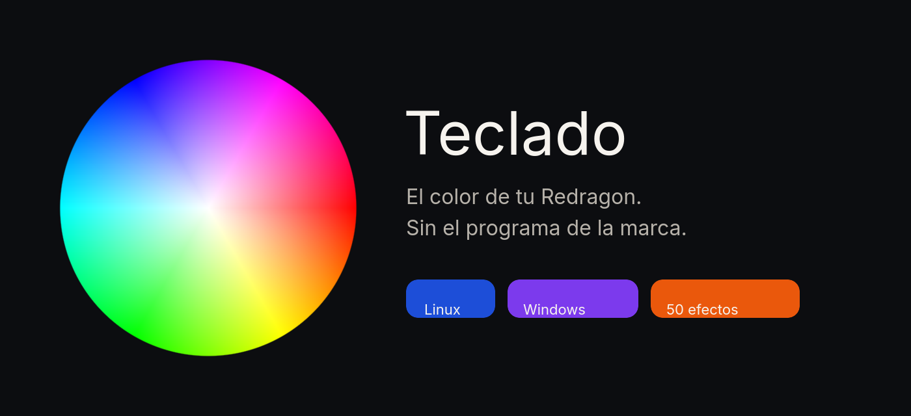

<p align="center">
  
</p>

<p align="center">
  Una ventana. Un color. El teclado se queda así aunque la cierres.
</p>

<p align="center">
  
</p>

Sirve para el teclado que el sistema ve como `258A:0049` (varios Redragon y el mismo chip con otro nombre). Solo pinta luces. No instala el programa de la marca y no toca el firmware.

## Linux

Hace falta Python 3 con ventana (`tk`).

```bash
git clone https://github.com/ErCharles/redragon-rgb.git
cd redragon-rgb
./instalar.sh
```

La primera vez pide la contraseña del sistema, una sola vez, para poder hablar con las luces. Después abre **Teclado** en el menú. El color sigue al cerrar y al reiniciar.

Si falta la ventana:

- Arch: `sudo pacman -S tk`
- Debian/Ubuntu: `sudo apt install python3-tk`
- Fedora: `sudo dnf install python3-tkinter`

## Windows

1. Instala Python desde [python.org](https://www.python.org/downloads/) y marca **Tcl/Tk**.
2. Descarga esta carpeta y ábrela.
3. Doble clic en **Instalar.bat**.

Se abre la misma ventana. La primera vez deja **Teclado** en el menú de inicio. El color sigue al cerrar y al reiniciar.

Si ya tienes Python, **Teclado.vbs** abre la ventana sin consola.

## Qué puedes hacer

- Elegir cualquier color en la rueda. El centro es blanco.
- Subir o bajar el brillo.
- Elegir uno de los 50 efectos. El primero es el más habitual.
- Apagar las luces.

El color fijo se queda en el teclado. Los efectos siguen solos, también con la ventana cerrada.

## Licencia

MIT.
