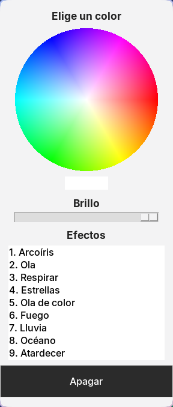

# Teclado

El color de tu Redragon, sin el programa de la marca.

  

[Descargar para Windows](https://github.com/ErCharles/redragon-rgb/releases/latest/download/Teclado-Windows.zip) · [Descargar para Linux](https://github.com/ErCharles/redragon-rgb/releases/latest/download/Teclado-Linux.zip)

Abre el archivo. Entra en la carpeta Teclado. Doble clic en el que empieza por 2.

## Windows

Si pide otro programa, se abre una página. Instala Python sin quitar ninguna casilla y vuelve a hacer doble clic.

## Linux

Si pregunta, elige Ejecutar. Escribe tu contraseña cuando la pida. Es solo para las luces. Después abre Teclado en el menú.

No borres la carpeta. El menú la usa.

El color se queda en el teclado. Los efectos siguen con la ventana cerrada.

Solo el teclado que el sistema ve como `258A:0049`. No toca el firmware.

## Licencia

MIT
